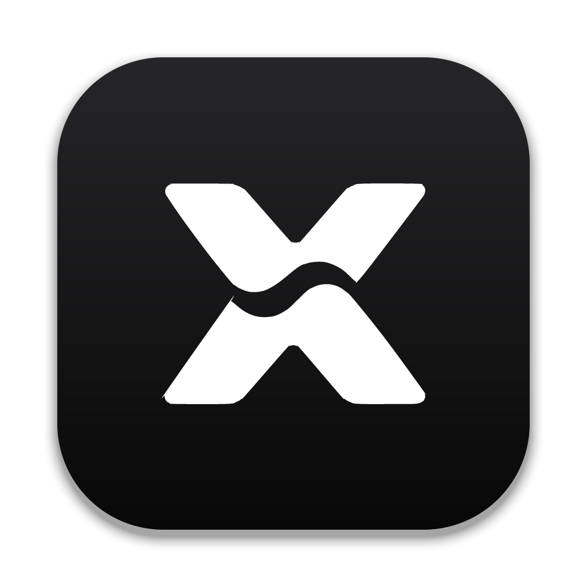

<p align="center">
  
</p>

<h1 align="center">Nothing X for Mac and Windows</h1>

<p align="center">
  Control your Nothing and CMF earbuds from the Mac menu bar or the Windows system tray.
</p>

<p align="center">
  <a href="https://github.com/yashraut362/nothing-x-mac/releases/latest"><b>Download</b></a>
  ·
  macOS 13+ (Apple Silicon and Intel) · Windows 10 and 11
</p>

<p align="center">
  Made by <a href="https://yashraut.me"><b>Yash Raut</b></a> · open to new roles
</p>

<p align="center">
  <a href="https://buymeacoffee.com/yashraut362"></a>
</p>

<p align="center">
  <a href="docs/media/demo.mp4">
    
  </a>
  <br>
  <sub>▶︎ <a href="docs/media/demo.mp4">Watch the full demo with sound</a> (38 s)</sub>
</p>

<p align="center">
  <a href="https://x.com/getpeid/status/2122427176977047884">
    
  </a>
</p>

---

Nothing's companion app, Nothing X, only exists for phones. On a computer, your
earbuds connect for audio, but you can't see their battery, switch noise
cancellation or change the EQ without picking up your phone.

This app puts those controls one click away:

- **Nothing X Mac** lives in the menu bar, styled like the AirPods menu so it
  feels at home on macOS.
- **Nothing X Windows** lives in the system tray, styled like the Windows 11
  quick settings flyout.

Both have the same features and are small downloads (under 10 MB). The app
talks to the earbuds directly over Bluetooth, with no account and no internet
connection. The demo above shows the Mac app.

## Features

- **Battery** for the left bud, right bud and case
- **Noise Control**: Noise Cancellation, Transparency or Off, with intensity
  (Low / Mid / High / Auto)
- **Bass Enhance** with a stepped level slider
- **Equalizer**: presets, plus a 3-band custom EQ with a live curve
- **Quick Settings**: In-Ear Detection, Low Latency, Personal Sound,
  Spatial Audio, Dual Connection and Find Buds
- **Controls**: click the left or right bud to change its tap gestures
- **Starts with your computer** (Open at Login on Mac, Start with Windows on
  Windows), and follows light and dark mode

Each model only shows the features it supports.

## Install

Pair and connect your earbuds in your computer's Bluetooth settings first.

### Mac

1. Download the latest **.dmg** from [Releases](https://github.com/yashraut362/nothing-x-mac/releases/latest),
   open it and drag **Nothing X Mac** into **Applications**.
2. Open it once. The app isn't notarized by Apple, so macOS blocks it the first
   time: go to **System Settings → Privacy & Security** and click **Open Anyway**.
   (Or run `xattr -dr com.apple.quarantine "/Applications/Nothing X Mac.app"`.)
3. Allow **Bluetooth** access when asked.

The app lives in the menu bar (no Dock icon); right-click its icon to quit or
turn off Open at Login.

### Windows

1. Download the latest Windows **setup .exe** from [Releases](https://github.com/yashraut362/nothing-x-mac/releases/latest)
   and run it. It installs for your user only, so it doesn't ask for an
   administrator password.
2. The installer isn't code-signed, so Windows shows **Windows protected your
   PC** the first time: click **More info → Run anyway**.
3. Click the app's icon in the system tray to open the panel. If you can't see
   the icon, it's under the **^** arrow next to the clock.

Right-click the tray icon to quit or turn on Start with Windows. On Windows 10,
the installer downloads Microsoft's WebView2 runtime if it's missing (Windows 11
already has it).

### Verify the download

Each release is scanned on VirusTotal. The SHA-256 in each link matches
`SHA256SUMS.txt` on the release, so you can check it's the same file.

| v0.1.0 | VirusTotal |
| --- | --- |
| `Nothing-X-Mac-0.1.0-universal.dmg` | [Scan report](https://www.virustotal.com/gui/file/17922dbf103660eb30e458da1f62b8491c149c5b51ebf27044ab2356ef869190) |
| `Nothing-X-Mac-0.1.0-universal.zip` | [Scan report](https://www.virustotal.com/gui/file/2489a7e9857c9c846e975bc3585a0946a56515a3869bb6181179a2ebb1351769) |

<!-- 0.2.0 release: replace the table above with the 0.2.0 files (Mac .dmg and
     .zip, Windows setup .exe) and their VirusTotal links. -->

To check a file yourself:

```bash
shasum -a 256 <downloaded file>                      # Mac
```

```powershell
Get-FileHash <downloaded file> -Algorithm SHA256     # Windows (PowerShell)
```

## Supported earbuds

Tested with **CMF Buds 2 Plus**. Other Nothing and CMF models (Ear, Ear (a),
Ear (2), Ear (3), CMF Buds, Buds 2, Buds Pro 2, Headphone (1) and more) use
per-model data from ear-web and should work, but haven't been tested yet.
Reports and fixes are welcome.

If the app keeps retrying to connect, close the Nothing X / CMF app on your
phone: the earbuds only let one app control them at a time.

## Development

The app is built with [Tauri](https://tauri.app): the UI and the earbud logic
run in the system web view, inside a small Rust shell. The Mac and Windows apps
share all of the UI and earbud code; only the Bluetooth transport, the icons
and one stylesheet differ.

You need [Rust](https://rustup.rs) and Node.js, plus:

- **Mac:** Xcode's command line tools.
- **Windows:** the Visual Studio C++ Build Tools ("Desktop development with
  C++") and the WebView2 runtime (built into Windows 11).

```bash
npm install
npm start
```

On a Mac, `npm start` also builds the Swift Bluetooth helper
(`native/mac/NXBridge.swift`), and macOS asks for Bluetooth permission on first
run. On Windows the app opens the Bluetooth channel itself.

Log every message to and from the earbuds:

```bash
NXM_DEBUG=1 npm start                  # Mac
```

```powershell
$env:NXM_DEBUG=1; npm start            # Windows (PowerShell)
```

Connection events and errors are also written to `bluetooth.log`, which is the
place to look when an installed build can't connect:

- **Mac:** `~/Library/Logs/com.nothingxmac.app/bluetooth.log`
- **Windows:** `%LOCALAPPDATA%\com.nothingxwin.app\logs\bluetooth.log`

### Build and release

On a Mac:

```bash
npm run dist          # universal app (Apple Silicon + Intel) -> src-tauri/target/
npm run install-app   # build and copy to /Applications
npm run release       # build, then DMG, zip and checksums -> release/v<version>/
npm run build:icon    # regenerate the app, tray and menu bar icons from web/assets/logo.svg
```

On Windows:

```bash
npm run dist:windows  # installer -> src-tauri/target/release/bundle/nsis/
```

The Windows installer is also built on GitHub (`.github/workflows/windows-build.yml`)
and attached to the workflow run.

Mac builds are ad-hoc signed, not notarized. Windows builds are not code-signed.

### Layout

```
web/                      Everything that runs in the web view (shared by all platforms)
  index.html, styles.css  Panel markup and styles (styles.windows.css: the Windows look)
  ui/                     Panel UI (one file per control / page)
  core/                   Earbud protocol and state
    protocol.js           Packet framing and CRC
    commands.js           Command ids and payload codecs
    models.js             Per-model capabilities (+ eq-presets.js, gesture-profiles.js)
    nothing-device.js     Device state; delegates to the feature modules below
    confirmed-setting.js  Waits for the buds to confirm a change
    equalizer.js  quick-settings.js  dual-connection.js  gestures.js
  platform/               Glue between the page and the app shell
src-tauri/                App shell (Rust): tray icon, panel window, native menus
  src/bridge/             Bluetooth byte transport: helper.rs runs the Mac helper,
                          winsock.rs opens the channel directly on Windows
  src/platform/           Per-OS code: panel icons, accent colour, start at login
  tauri.*.conf.json       Shared config plus one file per OS (window, bundle)
native/mac/NXBridge.swift Mac Bluetooth helper: finds the buds, relays raw bytes over stdio
scripts/                  Helper, icon and release builds
.github/workflows/        Windows installer build
```

## About the author

Built by **Yash Raut**. I enjoy shipping polished, native-feeling apps end to
end, from Bluetooth protocols to UI design.

**I'm currently looking for my next role.** If you're hiring, or this project
was useful to you, I'd love to hear from you: **[yashraut.me](https://yashraut.me)**.

If this app saves you reaching for your phone, you can
[buy me a coffee](https://buymeacoffee.com/yashraut362) ☕. It keeps the updates coming.

<a href="https://buymeacoffee.com/yashraut362"></a>

## Credits

The earbud protocol and per-model data come from
[ear-web](https://github.com/radiance-project/ear-web) by the Radiance project.

Unofficial project, not affiliated with or endorsed by Nothing Technology
Limited. "Nothing" and "CMF" are their trademarks.
